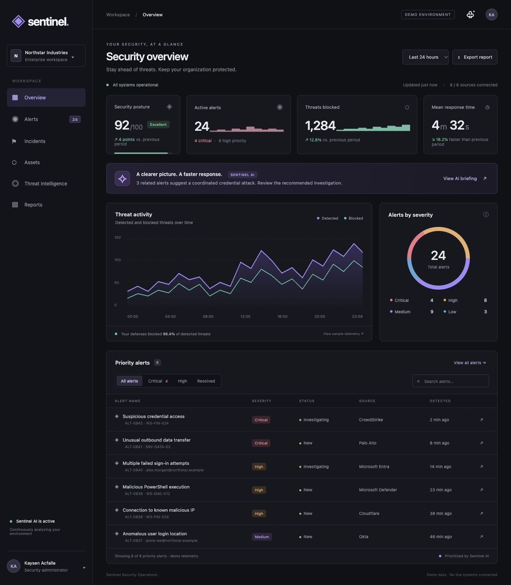

# Sentinel — Security Operations Dashboard

A responsive security operations dashboard prototype customized by **Kaysen Acfalle**, built with AI-assisted development using HTML, CSS, and JavaScript.

> **Demo project:** All organizations, alerts, assets, metrics, and security events are simulated. AI briefings are predefined examples, not live model output. No real security systems are connected.

## Live demo and screenshot

[Open the public live demo](https://sentinel-security-ops-kaysen.restedbike16.chatgpt.site/)



## Features

- Dark, responsive dashboard with security posture and threat activity visualizations
- Searchable priority alert queue with severity and status filters
- Investigation panels with sample MITRE ATT&CK mappings and suggested investigation steps
- Alert triage: mark investigating or resolved, with browser-local persistence
- Simulated AI security briefing and sample incident and asset views
- Downloadable JSON report containing sample alerts and triage status
- Keyboard-accessible controls and investigation dialogs

## Run locally

Requires Python 3 only for the development server; no package installation or build step is needed.

```sh
python3 -m http.server 4173 --directory docs
```

Open http://localhost:4173 in your browser.

## Project structure

```text
docs/
  index.html   # Dashboard layout and sample metrics
  style.css    # Responsive styling
  app.js       # Filters, investigation panels, triage, and report export
```

## Technical approach

The frontend uses plain HTML, CSS, and JavaScript, with SVG and CSS charts. Triage status is stored in localStorage on the visitor's browser. No backend, API keys, authentication system, or external dependencies are required.

The `docs` directory can be served directly as a static website, including through GitHub Pages when enabled in repository settings.

## Scope and limitations

- Summary metrics, charts, timestamps, source connection indicators, and AI text are illustrative static content.
- The time selector does not query different datasets; it displays a demo notice.
- Only the six priority alerts support interactive triage; headline totals represent a larger fictional sample.
- Resolving an alert changes browser-local demo state, not a real incident or endpoint.
- This is a portfolio prototype, not a production monitoring or incident-response system.

## Learning focus

This project explores security dashboard design, alert prioritization, investigation workflows, frontend interaction, local storage, static deployment, and AI-assisted prototyping. It does not claim operational security experience or independently implemented machine learning.

## Future improvements

- Connect an authorized telemetry source through a secure backend
- Compute charts and metrics from real event data
- Add authenticated access, audit logs, and durable incident storage
- Integrate an AI model with evidence-linked analysis and human review
- Add automated accessibility and interaction tests

## Credits

Created for Kaysen Acfalle with AI-assisted design and implementation using OpenAI Codex.
